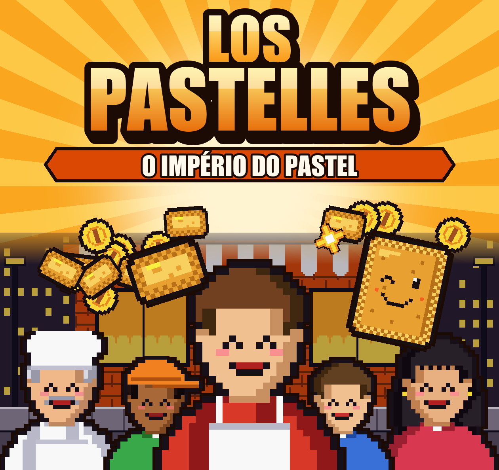
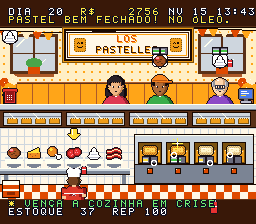
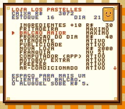

# Los Pastelles: O Império do Pastel

Jogo de gerenciamento de pastelaria para **Super Nintendo**, feito em assembly 65816.
Desenvolvido por **Ramon de Oliveira** — [www.lospastelles.com.br](https://www.lospastelles.com.br)

## Jogar
Baixe [`LosPastelles.sfc`](LosPastelles.sfc) e abra num emulador de SNES (Mesen, bsnes, Snes9x)
ou grave num cartucho flash (EverDrive, FXPAK).

 

Controles, conteúdo, segredos e instruções para gravar no cartucho estão no [LEIAME.md](LEIAME.md).
O manual está em [`cartucho/manual_los_pastelles.pdf`](cartucho/manual_los_pastelles.pdf) e o trailer em
[`trailer/trailer_los_pastelles.mp4`](trailer/trailer_los_pastelles.mp4).

## Recompilar
Requer Node.js, Python com Pillow e duas ferramentas que não acompanham o repositório:
- [cc65](https://cc65.github.io/) extraído em `tools/cc65` (o build usa `tools/cc65/bin/ca65` e `ld65`);
- [Mesen 2](https://www.mesen.ca/) em `tools/mesen` para jogar e em `teste/mesen` para os testes automáticos.

Depois é só rodar `node build.js`.

Os ícones dos menus vêm do [Twemoji](https://github.com/twitter/twemoji) (CC-BY 4.0).
